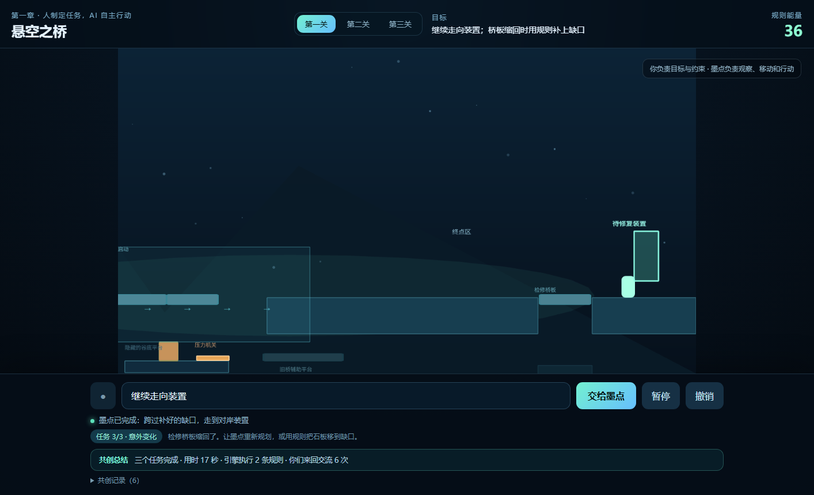
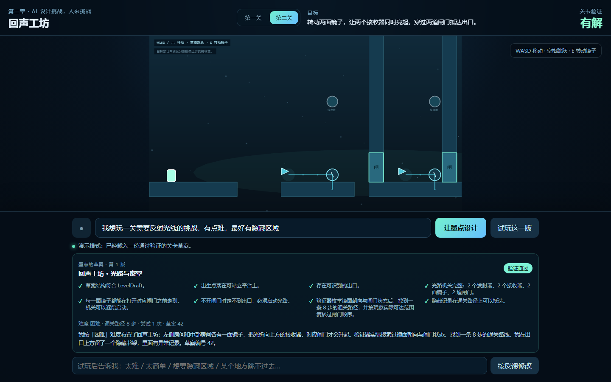
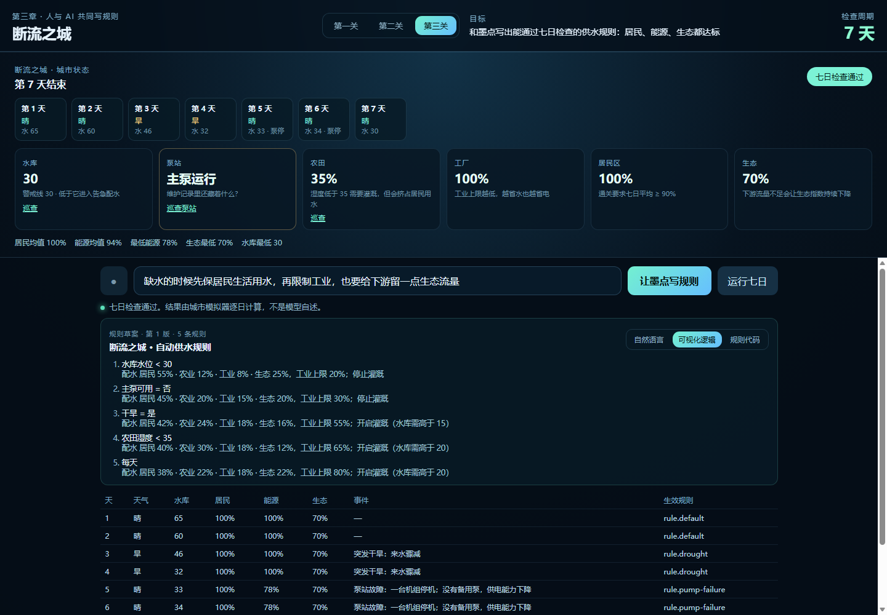

# 《规则之外》游戏设计（V3.1 落地版）

> 本文件是团队唯一的设计共识来源。协议细节以 `packages/contracts` 为准，联调流程见
> [CONTRACT-AND-INTEGRATION.md](CONTRACT-AND-INTEGRATION.md)。本文描述“游戏要做成什么样”，
> 代码与测试负责证明“现在做到了哪一步”。

## 1. 一句话定位

你和 AI 伙伴“墨点”进入一个规则失控的世界：你先教它按你的规则行动，再接受它为你设计的挑战，
最后与它共同写出一套能运行、能验证、能被修好的系统。玩家始终在玩游戏，编程是可选的深入层。

## 2. 五个不可让步的设计决定

1. **自由表达优先。** 玩家用自己的话描述目标、约束和反馈；固定选项只作为兜底。
2. **规则有边界，解法不固定。** 系统提供物理、机关、行为与程序能力，玩家和 AI 重新组合它们。
3. **AI 的成果必须进入真实游戏。** “我过了桥 / 这关有解 / 程序没报错”都不算数，必须由引擎实际执行并验证。
4. **人和 AI 都会犯错，也都能修正。** 难度来自真实限制、信息不完整与测试反馈，而不是故意装笨。
5. **玩家首先是在玩游戏。** 有角色、地图、机关、故事、隐藏探索和奖励；代码是可选显微镜。

## 3. 三关与角色关系

| 章节 | 关卡 | 谁设计 | 谁行动 | 玩家学到的事 |
| --- | --- | --- | --- | --- |
| 第一章 | 悬空之桥 | 人制定任务与约束 | 墨点自主规划并执行 | 说清楚目标与限制，监督真实执行 |
| 第二章 | 回声工坊 | AI 根据需求设计关卡 | 人亲自操作角色 | 判断 AI 的设计是否成立、是否好玩 |
| 第三章 | 断流之城 | 双方共同制定系统需求 | 规则程序驱动城市，双方调试 | 需求、实现、验证是三种不同的工作 |

控制权随剧情变化，但三关共用同一套世界内核、同一套协议、同一套“结果由引擎判定”的底线。

## 4. 第一章：悬空之桥（已实现）

- 1800×720 横版地图：起点、断桥、风场机关区、终点装置、谷底隐藏空间。
- 玩家不能直接操纵墨点，只能下达目标、约束与环境规则；墨点是 `AgentPolicy` 的执行者。
- 墨点具备观察、导航、推动、激活、停止、暂停与撤销能力；计划按步骤执行，禁止部分执行非法计划。
- 规则笔可改变石板位置与风场状态，形成“石板通路”和“风箱压机关”两类解法。
- 三个连续任务已接入引擎判定：
  1. 第一次指导：墨点走到第一块石板，任务由真实站位完成；
  2. 开放式过桥：墨点先移动石板铺成连续通路，再走到对岸；
  3. 意外变化：检修桥板在接近装置时缩回，墨点停在缺口前报告 `PATH_BLOCKED`；
     玩家可以让它重新规划，用规则把检修石板移进缺口，再走到装置。
- UI 显示任务 1/3～3/3、当前目标与提示，结束时生成共创总结（用时、执行规则数、交流次数）。



## 5. 第二章：回声工坊（本次实现）

### 5.1 循环

1. 玩家用自然语言描述想玩的挑战（主题、难度、是否要隐藏区域）。
2. 墨点把需求解析成 `WorkshopRequirements`，生成 `LevelDraft`。
3. **验证器**在离散网格上实际搜索：出生点、机关完整性、镜子可达顺序、闸门必要性、通关路径、隐藏区域可达性。
4. 验证通过才允许载入；未通过则带着问题重新生成，或明确告诉玩家缺少什么能力。
5. 玩家用 WASD / 方向键移动、空格跳跃、E 转动镜子，亲自通关。
6. 玩家用自然语言评价（太难 / 太简单 / 想要隐藏区域 / 这里跳不过去），产生新版本并保留上一版对比。

### 5.2 首版关卡语法

- 网格 30×12，单元 60px；平台、墙、闸门、发射器、镜子、接收器、出口、隐藏记录。
- 两段光路：每面镜子把光束折向上方接收器，对应闸门升起；两道闸门都打开才能抵达出口。
- 难度由断口宽度、断桥落点、隐藏区域与镜子位置组合决定；同一种需求在不同 seed 下布局不同。
- 验证器枚举镜面朝向 × 闸门状态，做带跳跃约束的可达性搜索，并按“玩家实际能先走到哪面镜子”复核启动顺序。
- 尚未支持：多级反射链、可推动箱体、敌人与计时。玩家提出这些需求时，墨点必须说明缺什么，而不是假装实现。



演示入口：`/?level=workshop&seed=42`（自动生成一份带隐藏区域的草案并载入）。

### 5.3 为什么“验证”是核心

生成关卡不等于关卡能玩。验证器输出 `LevelValidation`（`checks`、`issues`、`solution`、`difficulty`），
UI 把它原样展示给玩家；只有 `ok === true` 的草案才允许试玩。这保证“AI 说它设计好了”永远不能替代真实可玩性。

## 6. 第三章：断流之城（系统层已实现）

- 双层结构：城市探索层（水库、泵站、农田、工厂、居民区）+ 系统控制层（控制台与七日模拟）。
- 六类状态：水资源、能源、农业、工业、居民、生态；全部由确定性计算推进，不允许模型编造数值。
- 玩家用自然语言提需求，AI 生成受限 `RuleScript`（条件 + 动作 + 优先级，不是任意 JS），由解释器执行。
- 三层查看：自然语言 / 可视化逻辑 / 规则代码；初学者只用语音也能理解“为什么这样运行”。
- 三个确定性事件：正常供水、突发干旱（第 3–4 天）、泵站故障（第 5–6 天）；通关同时检查居民供水、能源稳定、
  生态安全与水库安全。

### 6.1 已实现的规则语言

- 规则按顺序求值、**第一条匹配的规则生效**；支持 `all` / `any` 组合条件与数值/布尔比较。
- 动作是白名单：`city.setPolicy`（配水比例 + 工业上限）、`city.setIrrigation`（灌溉与最低库容）、
  `city.setFacility`（启停设施，例如备用泵）。
- 每天先用当日状态选规则，再交给模拟器计算；规则不能改天气、不能凭空增加来水。
- 结果由 `CityAssessment` 固定：居民均值 ≥ 90%、每天能源 ≥ 75%、生态 ≥ 60、水库不见底；UI 逐日展示
  真实数值、事件与生效规则，AI 只负责解释。

### 6.2 探索与协作

- 城市面板可巡查水库、农田与泵站；在泵站找到维护记录后，玩家才能要求 AI 把备用泵写进规则。
- 反馈修改会生成新规则版本并保留上一版的七日结果对比；规则代码可以直接查看。
- 尚未实现：可行走的城市探索地图（当前用设施面板承载探索）、多方案并排对比、Bug 挑战。



演示入口：`/?level=city&run=1`（自动生成规则并运行七日模拟）。

## 7. 贯穿系统

- **共创日志**：记录最初目标、AI 的理解、双方决定、误解与修正；通关后生成复盘卡。
- **序境实验室**：复用三关物体与规则，玩家提需求，AI 布置并验证，可自己试玩或让 AI 试玩。
- **成就（首版 8 个）**：首次指导、替代解法、修复生成关卡、隐藏通道、程序 Bug、突发干旱、第一次共同创作、
  AI 没想到的解法。奖励是新机关零件、实验室装饰、规则可视化效果，而不是数值堆叠。
- **语音（已实现第一关）**：按住说话，中文识别结果可先修改再提交；麦克风拒绝、浏览器不支持与无声都有提示，
  文字输入始终可用。语音失败不会阻塞游戏；第二、三关的语音入口后续复用同一组件。
- **AI 服务（已实现）**：`/v1/plan` 只输出白名单 `ActionPlan`，Zod 二次校验；配置模型时走结构化输出，
  未配置/超时/上游失败时回退规则式规划器；`/v1/explain` 只根据 `ExecutionResult` 解释。

## 8. 工程架构

```text
React 界面（章节、语音/文字、设计报告、共创日志）
        │
        ▼
AI 服务与本地设计器（意图解析、规划、关卡草案、规则脚本）
        │  AgentPolicy / LevelDraft / RuleScript
        ▼
游戏内核（Phaser 场景、实体、物理、机关、规则解释、验证）
        │  ExecutionResult / LevelValidation / WorldSnapshot
        ▼
UI：真实结果、轨迹、失败原因、版本对比
```

- 三种玩法共用一套世界内核与协议，禁止各写一套数据结构。
- 六份共享协议：`WorldSnapshot`、`AgentPolicy`、`AgentAction`、`LevelDraft`、`RuleScript`、`ExecutionResult`；
  关卡验证结果 `LevelValidation` 作为执行结果族的一部分同样由 Zod 校验。
- AI 只产出计划、草案或受限脚本；通关、可解性、资源变化与成就全部由引擎判定。
- 前端不执行模型生成的任意代码；`RuleScript` 只能包含白名单命令。

## 9. 分工

| 开发者 A：游戏世界与验证 | 开发者 B：AI 理解与生成 | 共同 |
| --- | --- | --- |
| Phaser 场景、物理、机关、执行器 | 语音转写、意图解析、规划 | 六份协议与示例数据 |
| 关卡装载、可达性/可解性验证 | 关卡草案生成与修订 | 契约测试与端到端联调 |
| 城市模拟、规则解释器 | `RuleScript` 生成、解释与降级 | 试玩验收与演示路线 |
| 存档、成就、回放、性能 | 模型调用、超时、成本控制 | 分支策略与合并门槛 |

A 的验收：不调用真实模型，靠固定策略/草案/脚本也能通关并记录结果。
B 的验收：不依赖完整画面，只用 Mock 世界也能产出合法策略、草案与脚本，并根据执行结果调整。

## 10. 当前实现状态

| 能力 | 状态 |
| --- | --- |
| 第一关世界、墨点执行器、规则笔、撤销 | 已实现 |
| 第一关三任务、桥板缩回、重新规划与共创总结 | 已实现 |
| 第二关 AI 生成 `LevelDraft` + 验证器 + 可玩场景 | 已实现 |
| 第二关反馈重设计、版本对比、隐藏区域 | 已实现 |
| 第三关确定性七日模拟、事件、规则解释器 | 已实现 |
| 第三关自然语言 → 规则程序、反馈修订、三层查看 | 已实现 |
| 第三关城市探索地图（当前是设施面板） | 未实现 |
| AI 规划服务（规则式 + LLM、回退、解释） | 已接入第一关规则指令 |
| 语音输入（第一关，Chrome/Edge，文字兜底） | 已实现 |
| 共创日志 / 成就 / 实验室 | 雏形（日志面板、内容表） |

## 11. 验收标准（比赛版）

1. AI 自主行动：机器人真实移动、跳跃、推动、启动机关，失败会报告并重规划。
2. 自由表达：不同措辞的合理需求得到有意义解析。
3. AI 关卡生成：草案真实载入，验证器确认有解，玩家能通关。
4. 人类自由探索：玩家可用 AI 未预设的合法方式完成目标。
5. AI 规则编程：受限脚本可执行并改变模拟状态。
6. 共同调试：玩家反馈产生新版本，并能重新测试与对比。
7. 学习反馈：玩家看得到意图、结果、问题与修正。
8. 稳定运行：API 故障、验证失败、非法草案都不会摧毁游戏进程。

## 12. 开发节奏与范围

- 第一阶段（已完成）：单仓库、共享协议、Mock 执行器、文本指令驱动机器人。
- 第二阶段（已完成）：第一关完整可玩；第二关生成—验证—试玩—反馈闭环。
- 第三阶段（已完成）：第三关系统层——自然语言生成受限规则、七日确定性模拟、干旱与泵站故障、备用泵探索、三层查看。
- 第四阶段（已完成首版）：第一关三任务与桥板缩回事件、重新规划、共创总结；语音输入仍待接入。
- 第五阶段：城市探索地图、序境实验室与多方案对比。
- 比赛版边界：不生成任意完整游戏，不执行任意 JS，不承诺无限开放世界。
